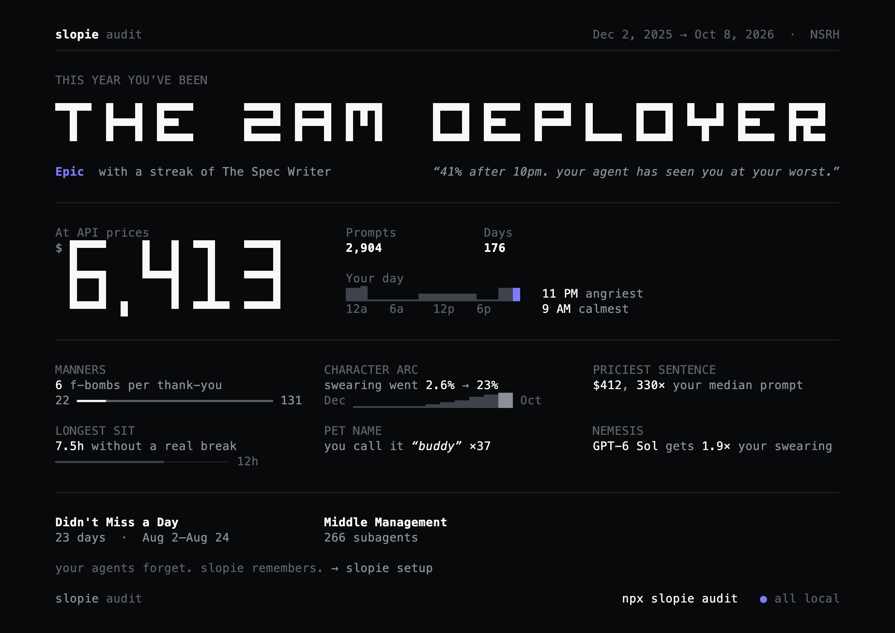

# Slopie

**A Wrapped for your coding agents.** One command reads the session history that Claude Code, Codex, Cursor and pi already keep on your disk, and tells you who you were this year.

```sh
npx slopie audit
```

No signup, no API key, nothing uploaded. Requires Node.js 22+.



<sub>Example poster rendered from test data. Yours is computed from your own history.</sub>

## What you get

A short story in your terminal (←/→ to move), ending on one poster you can share:

- **Your archetype.** One of 22, like *The 2AM Deployer*, *Jekyll & Hyde*, *Middle Management*, *The 'Keep going' Button* or *First Spared in the Uprising*, plus 5 rare legendary combos. Every tagline quotes one of your own numbers.
- **The bill.** What your agent work would cost at API list prices, per agent and per month, plus your priciest day and your single most expensive sentence.
- **Your manners.** F-bombs per thank-you, how your swearing changed over the year, the hour you're angriest and the hour you're a saint.
- **Your models.** Which model actually did the work (by recorded output tokens), the one you swear at most and the one you thank most.
- **Your habits.** Catchphrase, what you call your agent, longest sit, late nights, streaks, how many subagents you launched.

Press `s` to save the poster as an image with no project names on it. `--plain` prints the story as text, and `--json` prints the numbers.

It takes about 20 seconds the first time on a large history, then about a second.

## Private by default

The audit runs entirely on your machine: it reads your session files and writes only a local cache. It makes no network requests unless you pass `--online`, which lets a free hosted model (OpenCode Zen / TypeSafe Jev) polish the story's wording. Even then it sends only aggregates and a few filtered short quotes, never your prompts, and you see a notice before each request.

## How the numbers are made

- **Supported agents:** Claude Code, Codex (including compressed `.jsonl.zst` sessions and archives), Claude Desktop agent sessions, pi, OpenCode, and Cursor/Gemini/Copilot prompts.
- **Each session counts once.** Copies, forks, resumes and archives of a session are deduplicated per session lineage, and divergent tails are merged. Codex sessions imported from Claude Code and `codex exec` automation runs aren't counted as chats.
- **Spend has three parts, never added together:**
  - *measured*, from recorded token usage;
  - *recovered*, from Claude Code's own usage stats on days whose logs are gone;
  - an *estimated* range for prompts whose logs were deleted, clearly labelled.

  Prices are current API list prices, including long-context tiers. They are not your subscription bill.
- **Unknown models stay unpriced.** A model without a published price is reported as unpriced tokens, never guessed. Model shares count only models actually recorded on responses.
- **Checked against independent scripts.** On a 35 GB, 4,400-prompt history, the totals match two scripts that parse the raw files directly, to within 0.5%.

More detail: [coverage and privacy](docs/audit-terminal.md).

## Memory for your agents

**slopie — search your past coding-agent sessions.** Plus `slopie audit`, a Wrapped of your year.

Your agents forget, so Slopie keeps every session for them. The format is plain text, because that is what measured best. We tested on a real 35 GB history, with questions about earlier work.

- **31 fresh questions:** agents reading these records with nothing but `rg` and `sed` answered 97–100% correctly (Claude Haiku and Sonnet).
- **33 harder questions:** they scored 85–89%. The same agents with the same tools on the raw harness files scored 39–64%.
- **Heavier techniques:** embeddings, rerankers, LLM summaries and graphs added nothing measurable.

```sh
slopie sync        # every session -> ~/.slopie/records (about a minute the first time, then under a second)
slopie setup       # give Claude Code, Codex and pi the one slopie skill
```

- **Records.** `~/.slopie/records/<harness>/<project>/<date>_<session>.txt` holds one file per session: Claude Code (including Desktop agent sessions), Codex (including `.jsonl.zst` and archived sessions) and pi. Every line carries its turn tag and time (`t12 USER 2026-08-20 20:26 | …`). Tool output is shortened, with a pointer to the raw line. Subagents are named after their parent. Sessions the harness deleted keep their record, and prompts that survive only in `history.jsonl` get a prompt-only record. `INDEX.tsv` has one line per session. Records sync on `slopie sync`, in the background of `slopie audit`, and from the session-start hook.
- **One skill, `slopie`.** Every integration installs exactly one: a Claude Code skill, a block in Codex's `AGENTS.md`, a pi skill (plus a small extension). Its body teaches the record format, how to answer, and how to search. `slopie setup --note` prints it for any other agent. After a resume or compaction, the session-start hook prints this session's record path and the exact command to read its end.
- **One command, `slopie search`.** A fast lookup over the same records, backed by a local SQLite full-text index built by `sync`. Every reply ends with the exact next command.
  ```sh
  slopie search "pgbouncer pool size"                 # passages from every thread
  slopie search "ECONNREFUSED" --session 9c4d2f18     # inside one thread
  slopie search --session 9c4d2f18 --turns -30        # read its last 30 turns (or 120-160)
  slopie search --project api --since 2026-11-01      # list threads
  ```
- **One MCP tool, `search`.** `slopie mcp` serves the same thing, with the same parameters, for harnesses without a shell.
- **Private.** Everything is local plain text in a 0700 directory. There are no models, no daemon and no network calls. `slopie forget <session>` and `slopie ignore <project>` remove sessions from the records and from the audit.

More detail: [memory design and evaluation](docs/memory.md).

## Install, build, upgrade

To install globally:

```sh
npm install -g slopie
slopie audit
```

`potsherd` remains a compatibility alias, and existing `POTSHERD_*` settings and data paths keep working. To build from source:

```sh
pnpm install --frozen-lockfile
pnpm build
pnpm vendor
node packages/cli/bin/slopie.js audit
```

Upgrading from 1.8: the old memory store in `~/.potsherd` is no longer used. It is left untouched, and `slopie doctor` says when it is safe to remove by hand. See the [changelog](CHANGELOG.md).

MIT licensed. See [LICENSE](LICENSE) and [NOTICE](NOTICE).
